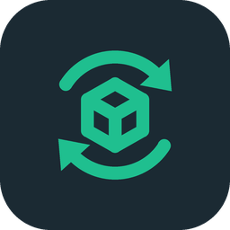

# WorldBaton

Share one Minecraft server with your friends. Whoever is online can host it.

**WorldBaton is an add-on for [SquidServers](https://squidservers.com), not a replacement.** It doesn't run
Minecraft servers: everyone who hosts still starts and stops the server in SquidServers, which also gives them the
address friends join with. WorldBaton handles the sharing part: it passes the world and the turn to host between you.

WorldBaton keeps a copy of your server folder on every friend's PC and passes the
"baton" (the right to host) between you, so only one person runs the world at a time
and nobody loses progress. No cloud, no accounts, no monthly cost: your PCs sync
directly with each other using [Syncthing](https://syncthing.net).

Made for SquidServers server folders; it also works with a plain server folder if you start that server
yourself. **WorldBaton is not made by or affiliated with SquidServers / Aqura LLC**, and
it doesn't modify their app: it only syncs your server folder.

> **Only use WorldBaton with people you would trust with full access to your computer.**
> Everyone in a group can put files on everyone else's PC: mods, configs, scripts, anything in the server folder.
> Mods are programs, so a harmful one runs with your access when you host the server or copy it into your own
> Minecraft. WorldBaton can't tell whether a file is safe; its change notices and activity list only help you
> notice things. The app asks everyone to accept this the first time they open it.

## Download

Get `WorldBaton.exe` from the [latest release](https://github.com/Potrosho/worldbaton/releases/latest).
Windows may warn that it's from an unknown publisher: click *More info → Run anyway*.
WorldBaton checks for updates each time it opens and offers to install them.

## How to use

1. **Owner:** open WorldBaton → *Create a group from my server* → pick your server folder
   (SquidServers keeps them in `%LOCALAPPDATA%\SquidServers`).
2. **Owner:** pick a group password → *Invite a friend* → send them the group code and the password.
3. **Friend:** *Join a friend's group* → paste the code → type the password.
4. The owner's WorldBaton lets them in on its own while it's open (the tray is enough), and the world starts
   copying. Only the owner can let people in, so the owner's PC has to be on for someone to join.
5. **To play:** press *Host now*, paste your SquidServers tunnel address, start the server in
   SquidServers. When done: stop the server there, then press *Stop hosting* and keep
   WorldBaton open until friends show 100% synced.

Friends see who is hosting and the address to join with.

### Also in the app

- **Several groups:** join or create as many as you like and switch between them; each keeps
  syncing in the background and has its own tunnel address. *Leave this group* keeps the files.
- **Notifications and tray:** told when someone starts hosting, when their server is up, when it's your turn
  and when the server changes. WorldBaton can stay in the tray and start with Windows (Settings).
- **Remove a friend** (owner only): their PC stops syncing with everyone and can't come back, even with the
  password. They keep the copy of the world they already have, so change the password if you're worried
  they shared it. After 10 wrong passwords in an hour, nobody can join for an hour.
- **Ask to host next** while someone else hosts; they're told, and you're told when it's your turn.
- **History:** every session with who hosted and for how long. Each PC keeps its last 2 hosted worlds, and
  any version with a backup can be restored for everyone.
- **Update my game's mods:** copies the server's mods into your own Minecraft; your own mods stay.
- **Discord:** a channel webhook (set once for the whole group) gets "server is up" and "stopped" posts.
- **Checks before hosting:** a nearly full drive, or a SquidServers server set up with a different loader version
  than the group's. (Java, RAM and the player list stay SquidServers' job.)

### Never online at the same time? Add a cloud copy

Normally the world goes straight from PC to PC, so two PCs need to be on together.
A cloud copy keeps the newest world in S3 storage, so anyone in the group can get it even when
nobody who has it is online. Cloudflare R2 and Backblaze B2 both have 10 GB free (R2 asks for a card).
WorldBaton keeps the newest 3 session zips there, so a world up to about 3 GB zipped stays free.

1. Make a bucket (private), and an API key that can read and write it:
   - **Cloudflare R2:** R2 → Create bucket. Then *Manage API tokens* → Create → *Object Read & Write* for that bucket.
     The endpoint is `https://<your account id>.r2.cloudflarestorage.com`.
   - **Backblaze B2:** Buckets → Create a Bucket (Private). Set its *Lifecycle Settings* to
     "Keep only the last version of the file", or deleted zips keep using space.
     Then Application Keys → Add a New Application Key with *Read and Write* access to that bucket.
     The endpoint is shown on the bucket, like `s3.us-west-004.backblazeb2.com`.
2. In WorldBaton: *Settings* → *Cloud copy*, fill in the endpoint, bucket, key ID and secret, and press
   *Check and save*. It's saved for the whole group, so only one person does this.

Every *Stop hosting* then uploads the world (*My group* shows the progress). When you want to host and
your copy is behind, WorldBaton downloads the newest one first. Who is hosting is also shown through
the cloud. Everyone in the group gets the keys: after removing a friend, make a new key and save it.

### Or a backup folder

Instead of S3 storage, you can share a folder in Google Drive, OneDrive or Dropbox,
install that drive's desktop app, and in WorldBaton press *Backup folder…* and pick it
(everyone picks their own copy of the same shared folder).

Every time someone presses *Stop hosting*, WorldBaton saves a zip of the world there
(the newest 3 are kept). When you want to host and your copy is behind, it loads the
newest zip first. Who is hosting is also shown through that folder, so it works even if
you never see each other online. Before turning off your PC, wait until the drive app
says it's up to date.

If your PC crashes while hosting, reopen WorldBaton: as long as nobody took over, press
*Stop hosting* to share what you played.

## How it works

- Each group is two Syncthing folders: the **world** (your server folder) and a tiny
  **baton** file (who is hosting, their address, a heartbeat, the world version).
- Joining: the friend's PC proves it knows the password without sending it (a code made from the password and
  that PC's ID, which works for no other PC). The owner's WorldBaton checks it and shares the group's folders with
  that PC; Syncthing then introduces it to everyone else, and removes it from everyone when the owner removes it.
- Only the last host sends world changes; everyone else's copy is receive-only, so stray
  edits on a friend's PC are undone instead of spread.
- Press *Host now* before starting the server (WorldBaton asks you to stop it otherwise). A server started
  when it isn't your turn pauses syncing on your PC, so friends never get its half-saved world, and what it
  changed is undone once it stops.
- While you host, your world folder is paused: friends never get half-saved files. Your
  session is shared once you press *Stop hosting*.
- You can only host when your copy matches the newest version. If the host's PC dies,
  friends can take over after 5 minutes without a heartbeat (that session is lost).
- Changes: when the server's mods, operators, datapacks, risky `server.properties` settings (RCON, command
  blocks, op level, online mode…) or logging gamerules change, everyone sees what changed (install the same
  mods in your own Minecraft to keep joining).
- Host activity: while you host, WorldBaton reads the server log every few seconds and shares admin commands
  (op, gamemode, give, tp, ban…, from players, the console, command blocks and RCON) with the group. It also
  flags ways around that: the log being edited, cut, replaced or not written; mods loaded from outside
  `mods/` (NeoForge); files changed while the server was off (NBT editors, copied-in worlds); WorldBaton being
  closed mid-session; and logging turned off by gamerule. Each PC keeps what it has seen, so entries deleted
  from a host's list stay visible, and a list changed by a PC other than its owner is flagged.
- What it can't catch: faked file timestamps, a modified server jar, client-side cheats (x-ray, fly), a wrong PC
  clock, and `/execute as Friend run …`, which the server logs under the friend's name (the list always shows
  who was hosting too). With `online-mode=false`, names aren't verified at all; WorldBaton warns about that.
- Logs, crash reports, caches and SquidServers' per-PC files (`squidservers/`,
  `.mc_server_state.json`) are not synced. Each person's tunnel stays their own.

## Limits (for now)

- WorldBaton doesn't host servers itself; you need SquidServers (or to start the server yourself). A basic
  built-in way to run the server may come in a future update.
- Windows only.
- Without a cloud copy or backup folder, two PCs must be online at the same time to pass the world on.
- WorldBaton can't tell when a cloud drive has finished uploading; the host has to check.
- Anyone in the group can host and change the world, so only invite people you trust.
  Syncthing keeps the last 3 versions of changed files in `.stversions` for recovery.
- To host from SquidServers, a friend first creates a server there with the same type and
  version (and a different name), then picks its folder with *Change server folder…*.
  WorldBaton fills it with the group's world, mods and config and keeps that PC's own
  start scripts and RAM setting.

## Development

```bash
pip install sv-ttk pystray pillow
```

```bash
python scripts/get_syncthing.py
```

```bash
python -m worldbaton
```

```bash
python -m unittest discover -s tests -v
```

The logo in `assets/` is drawn by `scripts/make_icon.py` (needs `pip install pillow`); rerun it after changing the design.

Build `dist\WorldBaton.exe` (needs `pip install pyinstaller`):

```bash
powershell -ExecutionPolicy Bypass -File build.ps1
```

### Publishing a release

1. Add a `## 0.2.0` section to `CHANGELOG.md` saying what changed, in plain words. It becomes the
   release notes, the update prompt and the app's *What's new* (the release fails without it).
2. Change `__version__` in `worldbaton/__init__.py` (e.g. `0.2.0`) and commit.
3. Tag and push:

```bash
git tag v0.2.0
```

```bash
git push origin main --tags
```

GitHub Actions tests, builds and publishes `WorldBaton.exe` as release `v0.2.0`.
Everyone's WorldBaton offers it as an update the next time they open it.

## License

WorldBaton is licensed under the [GPL-3.0](LICENSE).
Syncthing is © The Syncthing Authors, MPL-2.0; its license ships with the app.
